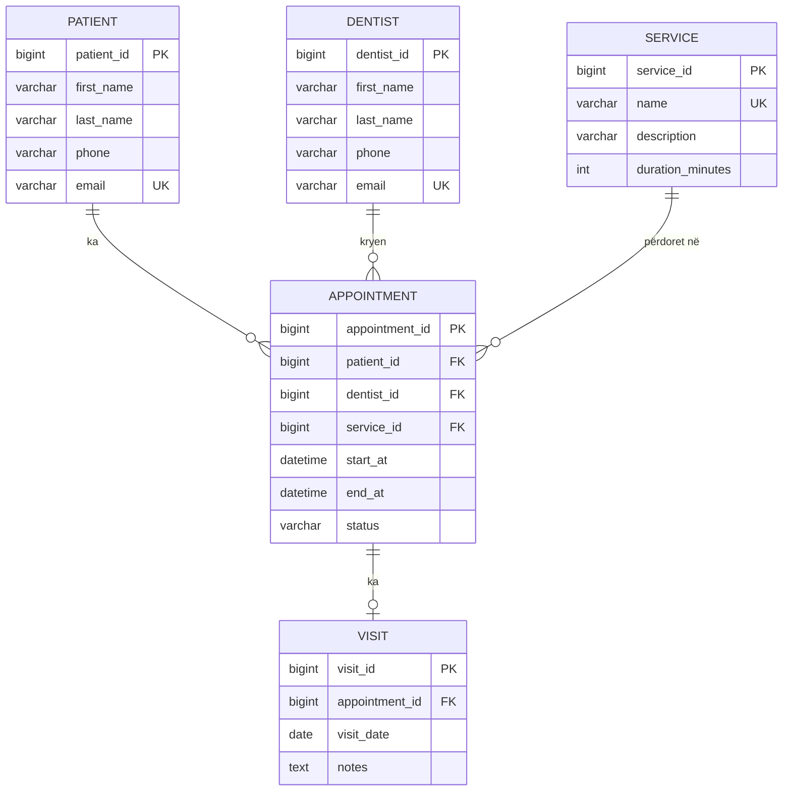
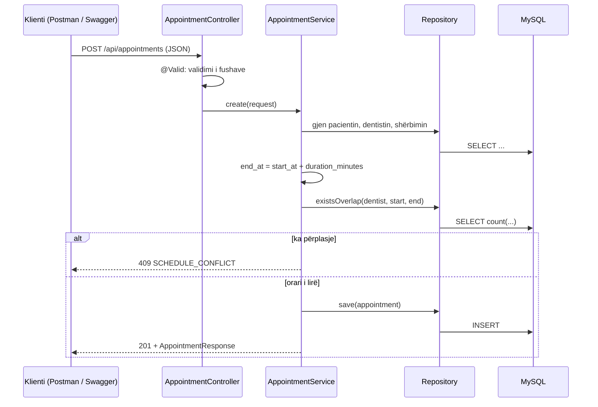

# Raporti Teknik 2 – Databaza, backend-i dhe API

**Sistemi për Menaxhimin e Ordinancave Dentare**

---

## 1. Hyrje

Në Raportin 1 u përcaktuan ideja, kërkesat dhe arkitektura e sistemit. Në këtë raport projekti kalon nga dizajni në implementim: është krijuar databaza reale, është ndërtuar backend-i dhe janë realizuar endpoint-et kryesore të REST API-së për pacientët, dentistët, shërbimet dhe terminet, përfshirë kontrollin e përplasjes së orarit.

Teknologjitë e përdorura, sipas propozimit të Raportit 1:

- **Java 17 + Spring Boot 3.3**, sepse lejon ndarjen e qartë të ndërfaqes, logjikës së biznesit dhe të dhënave, dhe jep REST API me pak kod bazë.
- **Spring Data JPA (Hibernate)** për qasje në databazë përmes entiteteve dhe query-ve të parametrizuara.
- **MySQL 8** si databazë relacionale, sepse të dhënat kanë lidhje të forta (pacient, dentist, shërbim, termin) dhe kërkojnë integritet referencial.
- **Bean Validation** për validimin e inputit dhe **Swagger UI (springdoc)** për dokumentim dhe provë të API-së.
- **JUnit 5 + Mockito** për teste njësi dhe **Postman/Swagger** për testim manual të endpoint-eve.

## 2. Databaza

Databaza `dental_clinic` ka 5 tabela (InnoDB, `utf8mb4_unicode_ci`) dhe krijohet realisht me skriptën `database/schema.sql`. Skripta nuk fshin asgjë: nëse databaza ekziston, ndalet me gabim. Fshirja për rinisje lokale është e ndarë te `database/reset.sql`.

### 2.1 Tabelat dhe lidhja me Raportin 1

| Entiteti në Raportin 1 | Tabela reale | Qëllimi | Statusi |
|---|---|---|---|
| Patient | `patient` | Pacientët: emri, mbiemri, telefoni, email-i | Realizuar |
| Dentist | `dentist` | Dentistët dhe kontaktet e tyre | Realizuar |
| Service | `service` | Shërbimet dentare dhe kohëzgjatja në minuta | Realizuar |
| Appointment | `appointment` | Terminet: lidh pacientin, dentistin dhe shërbimin, me fillim, fund dhe status | Realizuar |
| Visit | `visit` | Shënimi i vizitës për një termin | Tabela ekziston; endpoint-et në vijim (F07) |
| UserAccount (opsionale) | — | Llogaritë e stafit dhe rolet | Nuk është implementuar ende |

### 2.2 Ndryshimet nga versioni fillestar (Raporti 1)

| Tabela | Ndryshimi | Arsyeja |
|---|---|---|
| `appointment` | U shtua `end_at` | Kontrolli i përplasjes kërkon fillimin dhe fundin e terminit. Fundi llogaritet si `start_at + duration_minutes` i shërbimit dhe ruhet, që query-t e orarit të mos duhet të bëjnë JOIN me `service`. |
| `appointment` | `status` ka vlera të përcaktuara: `SCHEDULED`, `COMPLETED`, `CANCELLED` | J02 flet për "termine aktive"; vetëm `SCHEDULED` llogaritet aktiv. |
| `patient`, `dentist` | `email` është `UNIQUE` dhe opsional (`NULL`) | Parandalon dublikatet; disa pacientë nuk kanë email. |
| `service` | `name` është `UNIQUE` | Nuk ka kuptim dy shërbime me të njëjtin emër. |
| `visit` | `appointment_id` është `UNIQUE` | Një termin ka maksimumi një vizitë (relacion 1:1). |
| Të gjitha | Emrat e tabelave dhe kolonave në anglisht, me `snake_case` | Përputhen me emrat e entiteteve në Raportin 1 dhe me Java/JPA. |
| `UserAccount` | Nuk implementohet në këtë fazë | Autentikimi dhe rolet varen nga konfirmimi me profesorin (pyetje e hapur nga Raporti 1). |

### 2.3 Lidhjet kryesore

- `patient` 1 — N `appointment`: një pacient mund të ketë shumë termine me kalimin e kohës; çdo termin i takon një pacienti.
- `dentist` 1 — N `appointment`: njësoj; ky relacion është baza e kontrollit të orarit.
- `service` 1 — N `appointment`: një shërbim përdoret në shumë termine; çdo termin ka një shërbim. Nuk është many-to-many sepse një termin trajton një shërbim; nëse në të ardhmen duhen disa shërbime në një termin, do të shtohej tabelë ndërmjetëse.
- `appointment` 1 — 0..1 `visit`: një termin ka maksimumi një shënim vizite.



### 2.4 Kufizimet sipas tabelës

| Tabela | Foreign keys (ON DELETE) | UNIQUE / CHECK | Indekse |
|---|---|---|---|
| `patient` | — | UNIQUE `email` | `last_name` |
| `dentist` | — | UNIQUE `email` | — |
| `service` | — | UNIQUE `name`; CHECK `duration_minutes > 0` | — |
| `appointment` | `patient_id`, `dentist_id`, `service_id` (RESTRICT) | CHECK `status IN ('SCHEDULED','COMPLETED','CANCELLED')`; CHECK `end_at > start_at` | `(dentist_id, start_at, end_at)` |
| `visit` | `appointment_id` (RESTRICT) | UNIQUE `appointment_id` | — |

*Foreign key-t nuk kanë `ON DELETE` të shkruar shprehimisht; në InnoDB kjo do të thotë `RESTRICT`: rekordi i prindit nuk fshihet sa kohë ka fëmijë.*

Shembull nga skripta:

```sql
CREATE TABLE appointment (
    appointment_id BIGINT      NOT NULL AUTO_INCREMENT,
    patient_id     BIGINT      NOT NULL,
    dentist_id     BIGINT      NOT NULL,
    service_id     BIGINT      NOT NULL,
    start_at       DATETIME    NOT NULL,
    end_at         DATETIME    NOT NULL,
    status         VARCHAR(20) NOT NULL DEFAULT 'SCHEDULED',
    PRIMARY KEY (appointment_id),
    CONSTRAINT fk_appt_patient FOREIGN KEY (patient_id) REFERENCES patient (patient_id),
    CONSTRAINT fk_appt_dentist FOREIGN KEY (dentist_id) REFERENCES dentist (dentist_id),
    CONSTRAINT fk_appt_service FOREIGN KEY (service_id) REFERENCES service (service_id),
    CONSTRAINT chk_appt_status CHECK (status IN ('SCHEDULED','COMPLETED','CANCELLED')),
    CONSTRAINT chk_appt_time   CHECK (end_at > start_at),
    INDEX idx_appt_dentist_time (dentist_id, start_at, end_at)
) ENGINE=InnoDB;
```

### 2.5 Pse janë zgjedhur këto kufizime

- **`PRIMARY KEY BIGINT AUTO_INCREMENT`** te çdo tabelë: ID unike dhe e shpejtë për lidhje.
- **`UNIQUE` te `email`** (pacient, dentist): parandalon dy rekorde me të njëjtin email. `NULL` lejohet shumë herë, sepse email-i është opsional.
- **`UNIQUE service.name`**: parandalon dublikatet në katalogun e shërbimeve.
- **`UNIQUE visit.appointment_id`**: e bën relacionin termin–vizitë 1:1.
- **`NOT NULL`** te fushat pa të cilat rekordi nuk ka kuptim (emri, mbiemri, telefoni, kohëzgjatja, fillimi dhe fundi i terminit, statusi). Email-i dhe përshkrimi janë opsionalë.
- **`CHECK duration_minutes > 0`**: shërbim me kohëzgjatje 0 ose negative do ta prishte llogaritjen e `end_at`.
- **`CHECK end_at > start_at`**: mbrojtje në databazë edhe nëse backend-i gabon.
- **`CHECK status IN (...)`**: databaza refuzon çdo status të paparashikuar.
- **`ON DELETE RESTRICT`** te të gjitha lidhjet: historiku i termineve nuk humbet. Pacienti, dentisti ose shërbimi që ka termine nuk mund të fshihet, dhe termini që ka vizitë nuk fshihet. Anulimi bëhet me status, jo me fshirje.
- **Indekset** vetëm ku filtrohet shpesh: `(dentist_id, start_at, end_at)` mbështet kontrollin e orarit dhe filtrimin sipas dentistit dhe datës; `patient.last_name` mbështet kërkimin sipas emrit. Indekset nuk vendosen kudo sepse e ngadalësojnë shkrimin.

### 2.6 Rregulla që nuk i mbron databaza dhe zbatohen në backend

- **Pa përplasje orari:** një dentist nuk mund të ketë dy termine `SCHEDULED` që përputhen në kohë. Databaza nuk mund ta shprehë këtë me një constraint të thjeshtë, prandaj kontrollohet në `AppointmentService` përpara ruajtjes.
- **Llogaritja e `end_at`:** fundi nuk merret nga klienti; backend-i e llogarit si `start_at + duration_minutes` i shërbimit të zgjedhur.
- **Vetëm terminet `SCHEDULED` ndryshohen:** termini i anuluar ose i përfunduar nuk mund të ndryshohet; termini i përfunduar nuk mund të anulohet.
- **Koha në të ardhmen:** `startAt` duhet të jetë në të ardhmen kur rezervohet ose ndryshohet termini (validim `@Future`).
- **Ekzistenca e entiteteve:** para ruajtjes backend-i verifikon që pacienti, dentisti dhe shërbimi ekzistojnë dhe kthen 404 të qartë për secilin.
- **Email bosh → `NULL`:** një email i zbrazët ruhet si `NULL`, që `UNIQUE` të mos e trajtojë si vlerë të përbashkët.
- **Kufizim i njohur:** nëse dy kërkesa për të njëjtin orar vijnë në të njëjtën milisekondë, të dyja mund ta kalojnë kontrollin para se njëra të ruhet. Për një ordinancë me përdorim të ulët kjo është e pranueshme për semestrin; zgjidhja më e plotë do të ishte kyçja e rreshtit (`SELECT ... FOR UPDATE`) ose një mekanizëm përjashtimi në databazë.

### 2.7 Të dhëna testuese

Skripta `database/seed.sql` ngarkon të dhëna fiktive (pa të dhëna reale shëndetësore, sipas J06):

| Tabela | Rreshta | Përmbajtja |
|---|---|---|
| `patient` | 3 | Dy me email, një pa email |
| `dentist` | 2 | Me email unik |
| `service` | 3 | Kontroll (30 min), Pastrim (45 min), Mbushje (60 min) |
| `appointment` | 3 | Më 2026-11-20: dentisti 1 është i zënë 09:00–09:30 dhe 10:00–11:00; dentisti 2 është i zënë 09:00–09:45 |
| `visit` | 0 | Do të plotësohet kur të implementohet F07 |


## 3. Backend-i

### 3.1 Struktura e projektit

```
src/main/java/com/dentalms/
├── controller/   # endpoint-et REST: marrin kërkesën dhe kthejnë përgjigjen
├── service/      # logjika e biznesit (AppointmentService)
├── repository/   # qasja në databazë (Spring Data JPA, query-t e orarit)
├── model/        # entitetet JPA dhe enum-i AppointmentStatus
├── dto/          # AppointmentRequest / AppointmentResponse
└── exception/    # ApiException dhe GlobalExceptionHandler
database/         # schema.sql, seed.sql, reset.sql
src/test/         # teste njësi (Mockito)
```

Controller-ët e pacientëve, dentistëve dhe shërbimeve përdorin repository-n drejtpërdrejt, sepse janë CRUD i thjeshtë pa rregulla biznesi. Terminet kalojnë përmes `AppointmentService`, sepse kanë logjikë të vërtetë: kërkim i entiteteve të lidhura, llogaritje e fundit dhe kontroll orari.

### 3.2 Rrjedha e një kërkese (request → databazë)



1. Klienti dërgon kërkesën HTTP me trup JSON.
2. Spring e drejton te controller-i përkatës.
3. `@Valid` validon fushat (të detyrueshme, `startAt` në të ardhmen); nëse dështon, `GlobalExceptionHandler` kthen 400 `VALIDATION_ERROR` me detaje për secilën fushë.
4. Controller-i thërret `AppointmentService`, i cili gjen pacientin, dentistin dhe shërbimin (404 nëse mungon ndonjë).
5. Shërbimi llogarit `end_at` dhe zbaton rregullat e seksionit 2.6.
6. JPA ekzekuton query-t e parametrizuara brenda një transaksioni (`@Transactional`): `commit` ruan ndryshimet, kurse një përjashtim i shkakton `rollback`.
7. Serveri kthen JSON me status code përkatës; gabimet e biznesit kthehen si `ApiException`, kurse ato të databazës (dublikat, FK) si 409 `CONSTRAINT_VIOLATION`.

### 3.3 Autentikimi dhe autorizimi

Autentikimi dhe rolet (J03, J04) **nuk janë implementuar në këtë fazë**; endpoint-et janë të hapura gjatë zhvillimit. Kjo varet nga një pyetje e hapur nga Raporti 1 (a ka autentikim në versionin e semestrit). Plani është të shtohet `UserAccount` me fjalëkalim të hash-uar (BCrypt) dhe kontroll të qasjes sipas rolit përmes Spring Security. Kredencialet e databazës nuk ruhen në kod: lexohen nga `.env` ose variablat e ambientit.

### 3.4 Logjika e biznesit: rezervimi i terminit

Rezervimi është metoda më e rëndësishme e backend-it. Ekzekutohet si një transaksion i vetëm: ose ruhet termini, ose asgjë.

```java
@Transactional
public Appointment create(AppointmentRequest req) {
    Appointment a = new Appointment();
    apply(a, req);               // gjen pacientin, dentistin, shërbimin; llogarit end_at
    checkNoOverlap(a, -1L);      // -1 = asnjë termin nuk përjashtohet (termin i ri)
    return appointments.save(a);
}

private void checkNoOverlap(Appointment a, Long excludeId) {
    if (appointments.existsOverlap(a.getDentist().getId(), a.getStartAt(), a.getEndAt(), excludeId)) {
        throw new ApiException(HttpStatus.CONFLICT, "SCHEDULE_CONFLICT",
                "The dentist already has an appointment in this time slot.");
    }
}
```

Query-ja e përplasjes (`AppointmentRepository.existsOverlap`):

```java
select count(a) > 0 from Appointment a
where a.dentist.id = :dentistId
  and a.status = SCHEDULED
  and a.id <> :excludeId
  and a.startAt < :endAt
  and a.endAt > :startAt
```

Dy intervale `[s1, e1)` dhe `[s2, e2)` përplasen kur **`s1 < e2` dhe `e1 > s2`**. Kufiri i përbashkët (njëri përfundon kur tjetri fillon) nuk llogaritet përplasje. Shembull me të dhënat testuese, ku dentisti 1 është i zënë 10:00–11:00 dhe shërbimi zgjat 30 minuta:

| Termini i ri | Rezultati | Pse |
|---|---|---|
| 10:30–11:00 | Refuzohet | 10:30 < 11:00 dhe 11:00 > 10:00 |
| 09:45–10:15 | Refuzohet | 09:45 < 11:00 dhe 10:15 > 10:00 |
| 11:00–11:30 | Lejohet | 11:00 < 11:00 është false: vetëm kufiri përputhet |
| 12:00–12:30 | Lejohet | Larg intervalit ekzistues |

Terminet `CANCELLED` dhe `COMPLETED` nuk llogariten, prandaj anulimi e liron orarin automatikisht. Gjatë ndryshimit të terminit, `excludeId` e përjashton terminin vetë, që të mos përplaset me veten.

## 4. REST API

### 4.1 Formati i përgjigjeve

Përgjigjet e suksesshme kthejnë drejtpërdrejt objektin ose listën JSON (`201 Created` për krijim, `204 No Content` për fshirje). Gabimet kthehen gjithmonë në të njëjtin format, përmes `GlobalExceptionHandler`:

```json
{ "success": false, "error": "ERROR_CODE", "message": "Përshkrim i gabimit.", "details": { "fusha": "mesazhi" } }
```

Fusha `details` shfaqet vetëm për gabimet e validimit. Endpoint-et dhe mesazhet e gabimeve janë në anglisht, kurse fushat JSON janë `camelCase` (p.sh. `firstName`, `startAt`). Swagger UI: `http://localhost:8080/swagger-ui.html`.

### 4.2 Endpoint-et kryesore

| Metoda | Endpoint | Qëllimi | Status codes |
|---|---|---|---|
| GET | `/api/patients?search=` | Lista e pacientëve, me kërkim sipas emrit ose mbiemrit (F01) | 200 |
| GET | `/api/patients/{id}` | Një pacient | 200, 404 |
| POST | `/api/patients` | Regjistron pacient | 201, 400, 409 |
| PUT | `/api/patients/{id}` | Përditëson pacient | 200, 400, 404, 409 |
| DELETE | `/api/patients/{id}` | Fshin pacient (bllokohet nëse ka termine) | 204, 404, 409 |
| GET, POST, PUT, DELETE | `/api/dentists[/{id}]` | CRUD për dentistët (F02) | si pacientët |
| GET, POST, PUT, DELETE | `/api/services[/{id}]` | CRUD për shërbimet (F03) | si pacientët |
| GET | `/api/appointments?date=&dentistId=&status=` | Filtrim i termineve (F08) | 200, 400 |
| GET | `/api/appointments/{id}` | Një termin | 200, 404 |
| POST | `/api/appointments` | Rezervon termin me kontroll orari (F04, F05) | 201, 400, 404, 409 |
| PUT | `/api/appointments/{id}` | Ndryshon termin (F06) | 200, 400, 404, 409 |
| PATCH | `/api/appointments/{id}/cancel` | Anulon termin (F06) | 200, 404, 409 |

Endpoint-et për vizitat (F07) dhe për hyrje/role nuk ekzistojnë ende.

### 4.3 Shembuj kërkesash dhe përgjigjesh

**POST /api/patients**

```json
// Request
{ "firstName": "Valon", "lastName": "Rama", "phone": "+383 44 000 111", "email": "valon.test@example.com" }

// 201 Created
{ "id": 4, "firstName": "Valon", "lastName": "Rama", "phone": "+383 44 000 111", "email": "valon.test@example.com" }
```

**POST /api/appointments**

```json
// Request
{ "patientId": 1, "dentistId": 1, "serviceId": 1, "startAt": "2026-11-20T12:00:00" }

// 201 Created
{
  "id": 4,
  "patientId": 1, "patientName": "Arta Krasniqi",
  "dentistId": 1, "dentistName": "Liridon Gashi",
  "serviceId": 1, "serviceName": "Kontroll",
  "startAt": "2026-11-20T12:00:00", "endAt": "2026-11-20T12:30:00",
  "status": "SCHEDULED"
}
```

**PATCH /api/appointments/2/cancel**

```json
// 200 OK
{ "id": 2, "patientId": 2, "patientName": "Blerim Hoxha", "dentistId": 1, "dentistName": "Liridon Gashi",
  "serviceId": 3, "serviceName": "Mbushje", "startAt": "2026-11-20T10:00:00", "endAt": "2026-11-20T11:00:00",
  "status": "CANCELLED" }
```

**GET /api/appointments?date=2026-11-20&dentistId=1&status=SCHEDULED** kthen listën e termineve të dentistit 1 atë ditë, të renditura sipas orës.

### 4.4 Validimi dhe trajtimi i gabimeve

| Situata | HTTP | Kodi i gabimit |
|---|---|---|
| Mungon fushë e detyrueshme (p.sh. mbiemri te pacienti) | 400 | `VALIDATION_ERROR` |
| Email i pavlefshëm, kohëzgjatje < 1, ose `startAt` në të kaluarën | 400 | `VALIDATION_ERROR` |
| JSON i prishur, datë ose status me format të gabuar | 400 | `MALFORMED_REQUEST` |
| Pacienti, dentisti, shërbimi ose termini nuk ekziston | 404 | `PATIENT_NOT_FOUND`, `DENTIST_NOT_FOUND`, `SERVICE_NOT_FOUND`, `APPOINTMENT_NOT_FOUND` |
| Dentisti ka termin tjetër aktiv në atë kohë | 409 | `SCHEDULE_CONFLICT` |
| Ndryshim i terminit që nuk është `SCHEDULED`, ose anulim i terminit të përfunduar | 409 | `APPOINTMENT_NOT_EDITABLE` |
| Email ose emër shërbimi i dyfishtë (UNIQUE) | 409 | `CONSTRAINT_VIOLATION` |
| Fshirje e rekordit që përdoret nga termine (FOREIGN KEY) | 409 | `CONSTRAINT_VIOLATION` |

```json
// 400 – POST /api/patients me {"firstName": "Test"}
{
  "success": false,
  "error": "VALIDATION_ERROR",
  "message": "Request validation failed.",
  "details": { "lastName": "last_name is required", "phone": "phone is required" }
}

// 404 – GET /api/patients/9999
{ "success": false, "error": "PATIENT_NOT_FOUND", "message": "Patient does not exist." }

// 409 – termin që përplaset
{ "success": false, "error": "SCHEDULE_CONFLICT", "message": "The dentist already has an appointment in this time slot." }

// 409 – fshirje pacienti që ka termine
{
  "success": false,
  "error": "CONSTRAINT_VIOLATION",
  "message": "Operation violates a database constraint (duplicate value or record still in use)."
}
```

## 5. Testimi

### 5.1 Testimi manual me Postman / Swagger

Testet ekzekutohen mbi databazën e sapo-ngarkuar me `seed.sql`, sipas radhës më poshtë.

| Nr. | Test | Pritja | Rezultati |
|---|---|---|---|
| 1 | Rezervim për dentistin 1 më 2026-11-20 në 12:00 (shërbim 30 min) | 201; `endAt` = 12:30 | `[PLOTËSO]` |
| 2 | Rezervim për dentistin 1 në 10:30 | 409 `SCHEDULE_CONFLICT`; asgjë nuk ruhet | `[PLOTËSO]` |
| 3 | Rezervim për dentistin 1 në 09:45 (përplaset me 10:00) | 409 `SCHEDULE_CONFLICT` | `[PLOTËSO]` |
| 4 | Rezervim për dentistin 1 në 11:00 (kufi i përbashkët) | 201 | `[PLOTËSO]` |
| 5 | Rezervim për dentistin 2 në 10:00 (dentist tjetër, i lirë) | 201 | `[PLOTËSO]` |
| 6 | Rezervim me `serviceId` që nuk ekziston | 404 `SERVICE_NOT_FOUND` | `[PLOTËSO]` |
| 7 | Rezervim me `startAt` në të kaluarën | 400 `VALIDATION_ERROR` | `[PLOTËSO]` |
| 8 | Regjistrim pacienti pa mbiemër dhe telefon | 400 `VALIDATION_ERROR` me `details` | `[PLOTËSO]` |
| 9 | `GET /api/patients/9999` | 404 `PATIENT_NOT_FOUND` | `[PLOTËSO]` |
| 10 | Pacient me email që ekziston (`arta.test@example.com`) | 409 `CONSTRAINT_VIOLATION` | `[PLOTËSO]` |
| 11 | Fshirje e pacientit 1 (ka termin) | 409 `CONSTRAINT_VIOLATION` | `[PLOTËSO]` |
| 12 | Anulim i terminit 2, pastaj rezervim i dentistit 1 në 10:00 | Anulimi 200 `CANCELLED`; rezervimi 201 | `[PLOTËSO]` |
| 13 | `PUT` mbi terminin e anuluar | 409 `APPOINTMENT_NOT_EDITABLE` | `[PLOTËSO]` |
| 14 | `GET /api/appointments?date=2026-11-20&dentistId=1` | 200; vetëm terminet e dentistit 1 atë ditë | `[PLOTËSO]` |
| 15 | `GET /api/appointments?date=abc` | 400 `MALFORMED_REQUEST` | `[PLOTËSO]` |


### 5.2 Teste njësi

`AppointmentServiceTest` përdor Mockito (pa databazë) dhe kontrollon logjikën e termineve. Ekzekutohet me `mvn test`.

| Test | Çfarë kontrollon | Rezultati |
|---|---|---|
| `create_calculatesEndAtFromServiceDurationAndSaves` | `end_at` = fillimi + kohëzgjatja e shërbimit; statusi `SCHEDULED` | `[PLOTËSO]` |
| `create_throwsScheduleConflictAndDoesNotSave` | Kur ka përplasje hidhet `SCHEDULE_CONFLICT` dhe nuk thirret `save` | `[PLOTËSO]` |
| `create_throwsNotFoundWhenPatientMissing` | Pacient që mungon jep `PATIENT_NOT_FOUND` (404) | `[PLOTËSO]` |
| `cancel_setsStatusToCancelled` | Anulimi e kalon statusin në `CANCELLED` | `[PLOTËSO]` |
| `cancel_completedAppointmentIsRejected` | Termini i përfunduar nuk anulohet (`APPOINTMENT_NOT_EDITABLE`) | `[PLOTËSO]` |

## 6. Progresi në Git

Repository-i: `[PLOTËSO: linku]`

| Data | Commit | Përshkrimi |
|---|---|---|
| `[PLOTËSO]` | `docs: add Technical Report 1` | Raporti 1 |
| `[PLOTËSO]` | `chore: initialize Spring Boot project` | Struktura bazë, `pom.xml`, konfigurimi |
| `[PLOTËSO]` | `feat: add database schema and seed data` | Skripta SQL dhe të dhënat testuese |
| `[PLOTËSO]` | `feat: add entities and repositories` | Entitetet JPA dhe repository-t |
| `[PLOTËSO]` | `feat: add global error handling` | Formati i njësuar i gabimeve |
| `[PLOTËSO]` | `feat: add patient, dentist and service CRUD` | Moduli i entiteteve bazë |
| `[PLOTËSO]` | `feat: add appointment booking with schedule conflict check` | Terminet dhe kontrolli i orarit |
| `[PLOTËSO]` | `test: add AppointmentService unit tests` | Teste njësi |
| `[PLOTËSO]` | `docs: add README and Technical Report 2` | Dokumentimi |

*(Zëvendësoje me daljen reale të komandës `git log --oneline`.)*

## 7. Vendime teknike dhe probleme

### 7.1 Vendime teknike

| Vendimi | Arsyeja |
|---|---|
| `end_at` ruhet në databazë, jo vetëm llogaritet | Kontrolli i orarit bëhet me një query të vetme mbi `appointment`, pa JOIN me `service`, dhe ruan intervalin e saktë edhe nëse kohëzgjatja e shërbimit ndryshon më vonë. |
| Anulimi ndryshon statusin, nuk fshin | Ruhet historiku dhe orari lirohet automatikisht, sepse kontrolli shikon vetëm terminet `SCHEDULED`. |
| DTO për terminet (`AppointmentRequest` / `AppointmentResponse`) | Klienti dërgon vetëm ID-të dhe orën; nuk mund të dërgojë `endAt` ose status të sajuar. Përgjigja kthen emrat e lexueshëm pa ekspozuar entitetet e plota. |
| `ddl-auto=none` | Skema ndryshohet vetëm nga `schema.sql`, jo automatikisht nga Hibernate, kështu që databaza mbetet e kontrolluar dhe e dokumentuar. |
| Kredencialet në `.env` / variabla ambienti | Fjalëkalimi i databazës nuk futet në repository. |
| `schema.sql` nuk përmban `DROP DATABASE` | Parandalon fshirjen aksidentale të të dhënave; fshirja është në `reset.sql`. |

### 7.2 Probleme të hasura dhe zgjidhjet


## 8. Përgjigje për pyetjet tipike

**Çfarë ndodh nga momenti kur vjen request-i deri te ruajtja në databazë?**
Spring e drejton kërkesën te controller-i, `@Valid` e validon input-in, `AppointmentService` gjen pacientin, dentistin dhe shërbimin, llogarit `end_at` dhe kontrollon përplasjen me një query të parametrizuar. Nëse orari është i lirë, JPA bën `INSERT` brenda transaksionit dhe `commit` e ruan; nëse ndodh gabim, bëhet `rollback`. Në fund kthehet JSON me status code përkatës.

**Si parandalohet një e dhënë e pavlefshme?**
Në tri nivele: validim në API (fusha të detyrueshme, email i vlefshëm, `startAt` në të ardhmen), rregulla biznesi në shërbim (ekzistenca e entiteteve, pa përplasje, vetëm `SCHEDULED` ndryshohet), dhe kufizime në databazë (`NOT NULL`, `UNIQUE`, `CHECK`, `FOREIGN KEY`) si mbrojtje e fundit.

**Pse kjo lidhje në databazë është modeluar kështu?**
`appointment` është tabela qendrore që lidh `patient`, `dentist` dhe `service`, secilën me relacion një-me-shumë. `service` nuk është many-to-many me terminin sepse një termin trajton një shërbim. `visit` është 1:1 me `appointment` (`UNIQUE appointment_id`), sepse një termin ka maksimumi një shënim vizite.

**Pse `ON DELETE RESTRICT` kudo?**
Historiku i termineve nuk duhet të humbasë me fshirjen e një pacienti, dentisti ose shërbimi. Në vend të fshirjes përdoret anulimi me status. Nëse dikush provon të fshijë rekord që përdoret, databaza e refuzon dhe API kthen 409 `CONSTRAINT_VIOLATION`.

**Si kontrollohet që një përdorues nuk mund të ndryshojë të dhënat e dikujt tjetër?**
Në këtë fazë nuk ka autentikim, prandaj ky kontroll nuk ekziston ende. Plani është Spring Security me role (administrator, recepsionist, dentist) dhe kontroll që dentisti shikon vetëm terminet e veta, me ID-në e përdoruesit marrë nga sesioni ose tokeni, kurrë nga trupi i kërkesës.

**Çfarë nuk mbron databaza dhe ku kontrollohet?**
Përplasja e orareve: databaza nuk e shpreh dot me constraint të thjeshtë, prandaj kontrollohet në backend me query `existsOverlap`. Kufizimi i njohur është se dy kërkesa të njëkohshme mund ta kalojnë të dyja kontrollin; zgjidhja do të ishte kyçja e rreshtit ose një mekanizëm përjashtimi në databazë.

## 9. Çfarë demonstrohet gjatë prezantimit

- Databaza reale me të dhëna testuese dhe lidhjet kryesore (tabelat, FK, indeksi i orarit)
- CRUD për pacientët; rezervimi, ndryshimi dhe anulimi i termineve
- Kontrolli i orarit: rast i suksesshëm, rast përplasjeje, rast në kufi dhe lirimi i orarit pas anulimit
- Thirrje reale të API-së me Postman ose Swagger, përfshirë raste gabimi (400, 404, 409)
- Kodi i `AppointmentService` dhe query-t `existsOverlap`
- Git history nga Raporti 1 deri në Raportin 2

## 10. Çka mbetet deri te Raporti 3

| Detyra | Rezultati i pritur |
|---|---|
| Frontend me React: lista dhe formulari i pacientëve | Faqe funksionale e lidhur me API-në |
| Faqja e terminit me zgjedhje të pacientit, dentistit, shërbimit dhe orës, me shfaqje të gabimit të përplasjes | Një flow i plotë nga UI deri në databazë |
| Filtrimi i termineve në UI | F08 në ndërfaqe |
| Endpoint-et dhe UI për vizitat (F07) | Shënime vizite për termine të përfunduara |
| Gjendjet loading, empty dhe error në UI | Përvojë e qëndrueshme përdorimi |
| Vendimi për autentikim dhe role; handler për gabime të papritura 500 | J03/J04 sipas vendimit |

## 11. Lista e dorëzimit

- ☐ Prezantimi teknik me demonstrim real
- ☐ Versioni aktual i repository-t
- ☐ Skema e përditësuar e databazës (diagrami ER + skripta SQL)
- ☐ Dokumentimi i endpoint-eve (kjo tabelë + Swagger / koleksioni Postman)
- ☐ Shënimi për problemet teknike dhe zgjidhjet (seksioni 7)
