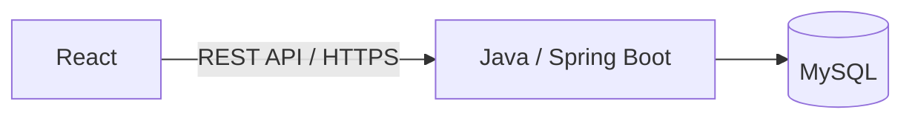
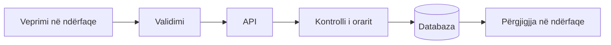

# RAPORTI TEKNIK 1

## Sistemi për Menaxhimin e Ordinancave Dentare
**Analiza, kërkesat dhe dizajni teknik**

| | |
|---|---|
| **Përgatiti** | Agon Fetahi |
| **Programi** | Dizajn Softueri |
| **Lënda** | Projekt (Praktikë Profesionale) |
| **Profesori** | Prof. Ass. Dr. Endrit Fetahi |

> Versioni Word i këtij raporti: [Raporti-Teknik-1.docx](Raporti-Teknik-1.docx)

---

## Përmbledhje e projektit

Ky raport paraqet analizën fillestare dhe dizajnin teknik të një sistemi për menaxhimin e ordinancave dentare. Sistemi synon të organizojë pacientët, dentistët, shërbimet dhe terminet në një vend të vetëm, me të dhëna të strukturuara dhe rrjedhë të qartë të punës. Ky është propozim për fazën e parë; teknologjitë dhe kufijtë përfundimtarë do të konfirmohen me profesorin para implementimit.

## 1. Problemi dhe përdoruesit

Ordinancat dentare mund t'i mbajnë të dhënat e pacientëve dhe terminet në dokumente ose mjete të ndara. Kjo e vështirëson gjetjen e informatave, kontrollin e orareve dhe përcjelljen e vizitave. Projekti propozon një aplikacion që i lidh këto të dhëna dhe e bën më të lehtë organizimin e punës së përditshme.

| Përdoruesi | Nevoja kryesore |
|---|---|
| Administratori / recepsionisti | Regjistron pacientë, organizon termine dhe mirëmban të dhënat bazë. |
| Dentisti | Shikon terminet e veta dhe regjistron shënime për vizitat e përfunduara. |
| Pacienti (fazë e ardhshme) | Mund të shikojë ose kërkojë termin e vet, nëse kjo përfshihet në scope. |

## 2. Qëllimi dhe kufiri i projektit

Qëllimi është të ndërtohet një aplikacion funksional për menaxhimin bazë të një ordinancë dentare, me ruajtje të të dhënave në databazë dhe me rrjedha që mund të demonstrohen. Për semestrin propozohet të përqendrohet puna në pacientë, termine, dentistë, shërbime dhe vizita. Pagesat online, faturimi i avancuar, SMS/email automatike dhe aplikacioni mobil i veçantë lihen jashtë scope-it fillestar për të mbajtur projektin të përfundueshëm.

## 3. Funksionalitetet e planifikuara

| ID | Funksionalitet | Përshkrimi |
|---|---|---|
| F01 | Menaxhimi i pacientëve | Stafi mund të regjistrojë pacient me emër, mbiemër dhe kontakt; lista mund të kërkohet sipas emrit. |
| F02 | Menaxhimi i dentistëve | Administratori mund të shtojë dhe përditësojë dentistët dhe kontaktet e tyre. |
| F03 | Menaxhimi i shërbimeve | Stafi mund të ruajë emrin dhe përshkrimin e shërbimit dentar. |
| F04 | Rezervimi i terminit | Stafi mund të caktojë pacientin, dentistin, datën/orën dhe shërbimin për një termin. |
| F05 | Kontrolli i orarit | Sistemi refuzon një termin nëse dentisti ka termin tjetër në të njëjtën kohë. |
| F06 | Ndryshimi/anulimi i terminit | Stafi mund të përditësojë ose anulojë termin dhe statusin e tij. |
| F07 | Regjistrimi i vizitës | Dentisti mund të shtojë datën dhe shënime të vizitës përkatëse të pacientit. |
| F08 | Kërkimi dhe filtrimi | Stafi mund të filtrojë terminet sipas datës, dentistit dhe statusit. |

## 4. Kërkesat jofunksionale

| ID | Kërkesa e matshme |
|---|---|
| J01 | Fushat e detyrueshme validohen para ruajtjes; gabimet shfaqen me mesazh të kuptueshëm. |
| J02 | Një dentist nuk mund të ketë dy termine aktive që përputhen në kohë. |
| J03 | Qasja në funksionet administrative kufizohet sipas rolit, nëse autentikimi përfshihet në versionin e semestrit. |
| J04 | Fjalëkalimet nuk ruhen si tekst i thjeshtë; përdoret mekanizëm hashimi i përshtatshëm. |
| J05 | Aplikacioni duhet të jetë i përdorshëm në ekran desktop dhe mobil për rrjedhat kryesore. |
| J06 | Të dhënat demonstruese/testuese nuk përmbajnë të dhëna reale shëndetësore të pacientëve. |

## 5. Arkitektura dhe teknologjitë e propozuara

Propozim fillestar: frontend me React, backend me Java dhe Spring Boot, databazë MySQL. Ky kombinim lejon ndarjen e ndërfaqes, logjikës së aplikacionit dhe të dhënave. Meqë implementimi ende nuk ka filluar, zgjedhja duhet të konfirmohet me profesorin dhe të përshtatet me kërkesat e lëndës.

| Shtresa | Propozimi | Përgjegjësia |
|---|---|---|
| Frontend | React | Faqet, format, validimi fillestar dhe paraqitja e të dhënave. |
| API / backend | Java + Spring Boot | Rregullat e biznesit, kontrolli i roleve dhe API për frontend-in. |
| Databaza | MySQL | Ruajtja relacionale e pacientëve, termineve, dentistëve dhe vizitave. |
| Versionimi | Git + GitHub | Historia e zhvillimit, commit-et dhe repository i projektit. |

## 6. Modeli fillestar i databazës

Modeli fillestar përmban këto entitete. Fushat e hollësishme mund të ndryshojnë gjatë projektimit dhe implementimit. Të dhënat e shëndetit duhet të kufizohen te ato që nevojiten për demonstrimin dhe funksionimin e projektit.

| Entiteti | Fusha kryesore të propozuara | Marrëdhënia |
|---|---|---|
| Patient | patient_id (PK), first_name, last_name, phone, email | Një pacient mund të ketë shumë termine dhe vizita. |
| Dentist | dentist_id (PK), first_name, last_name, phone, email | Një dentist mund të ketë shumë termine. |
| Service | service_id (PK), name, description, duration_minutes | Një shërbim mund të përdoret në shumë termine. |
| Appointment | appointment_id (PK), patient_id (FK), dentist_id (FK), service_id (FK), start_at, status | Çdo termin lidhet me një pacient, dentist dhe shërbim. |
| Visit | visit_id (PK), appointment_id (FK), visit_date, notes | Një termin i përfunduar mund të ketë një shënim vizite. |
| UserAccount (opsionale) | user_id (PK), username, password_hash, role | Përdoret për hyrje dhe role të stafit, nëse përfshihet. |

*Shkurtesat: PK = çelës primar; FK = çelës i huaj.*

## 7. Rrjedha kryesore e punës

Shembull: recepsionisti hap formularin e terminit, zgjedh pacientin, dentistin, shërbimin dhe kohën. Sistemi kontrollon fushat e kërkuara dhe disponueshmërinë e dentistit. Nëse orari është i lirë, backend-i e ruan terminin në databazë dhe ndërfaqja e shfaq në listë. Nëse orari është i zënë ose të dhënat janë të pavlefshme, përdoruesi merr mesazh dhe termini nuk ruhet.

## 8. Plani deri te Raporti Teknik 2

| Faza | Puna e planifikuar | Rezultati i pritshëm |
|---|---|---|
| 1 | Konfirmimi i scope-it dhe stack-ut me profesorin. | Kërkesa dhe teknologji të qarta. |
| 2 | Krijimi i strukturës së projektit dhe skemës së databazës. | Entitetet dhe relacionet fillestare të implementuara. |
| 3 | Implementimi i backend-it për pacientë, dentistë dhe termine. | CRUD bazik dhe rregulli i kontrollit të orarit. |
| 4 | Shtimi i të dhënave testuese dhe testimi i API-së. | Demonstrim me raste të suksesshme dhe gabimi. |
| 5 | Përditësimi i README-së dhe commit-eve. | Udhëzime ekzekutimi dhe histori progresi në GitHub. |

## 9. Demonstrimi dhe pyetjet e hapura

Për Raportin Teknik 1 do të prezantohet problemi, përdoruesit, funksionalitetet, kërkesat, arkitektura e propozuar, modeli fillestar i databazës dhe plani i punës. Në këtë fazë nuk paraqitet aplikacion si i përfunduar; implementimi i backend-it, databazës dhe API-së planifikohet për fazën pasuese.

- Konfirmimi me profesorin i stack-ut React, Java/Spring Boot dhe MySQL.
- Konfirmimi nëse sistemi do të ketë autentikim dhe role në versionin fillestar.
- Konfirmimi nëse pacientët do të kenë llogari dhe do të rezervojnë vetë termine.
- Përcaktimi i fushave të lejuara për shënimet e vizitave dhe nivelit të detajeve shëndetësore.

## 10. Përfundim

Raporti përcakton një bazë të realizueshme për Sistemin për Menaxhimin e Ordinancave Dentare: një grup fillestar funksionalitetesh, kërkesa të kontrollueshme, model të të dhënave dhe arkitekturë të propozuar. Hapi i radhës është marrja e feedback-ut të profesorit dhe fillimi i databazës dhe backend-it, duke dokumentuar progresin me commit-e të rregullta.
