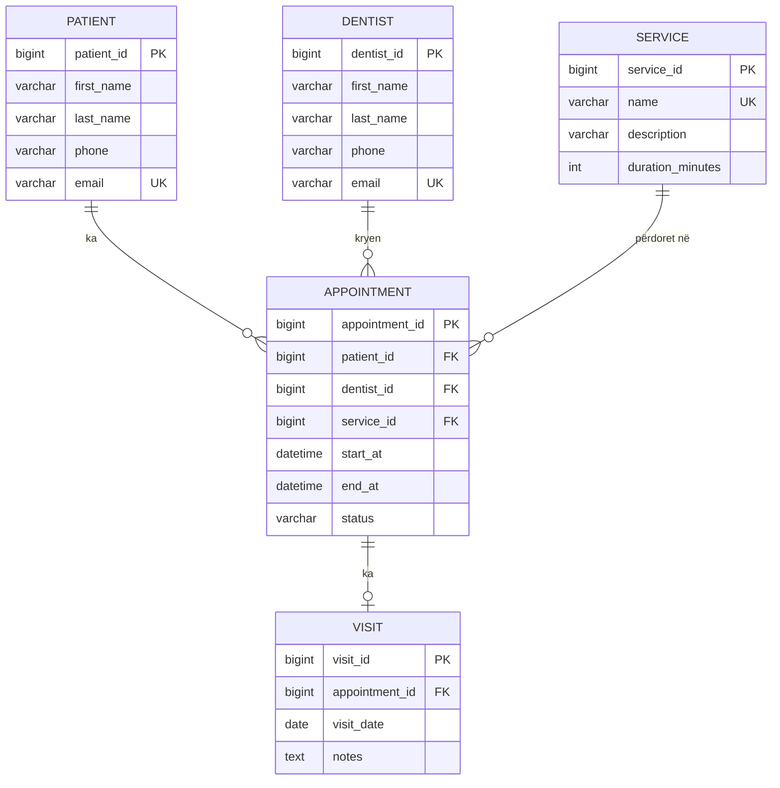
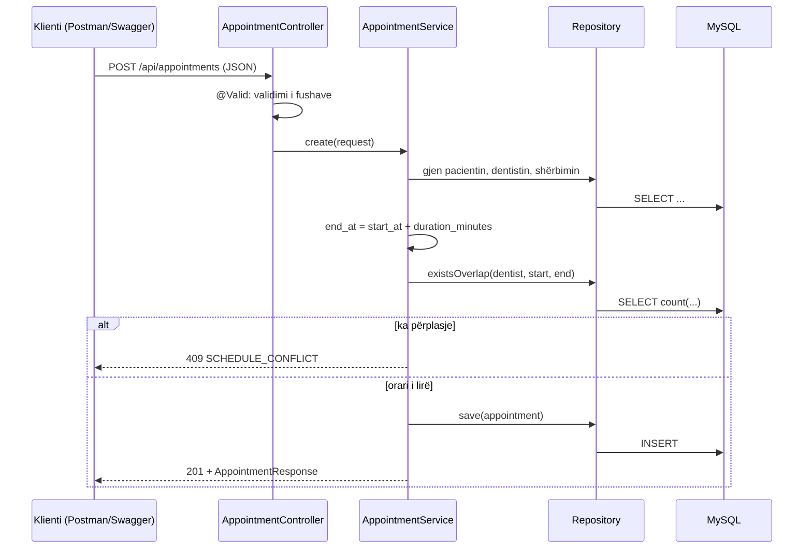

# RAPORTI TEKNIK 2

## Databaza, backend-i dhe API
**Sistemi për Menaxhimin e Ordinancave Dentare**

| | |
|---|---|
| **Përgatiti** | Agon Fetahi |
| **Programi** | Dizajn Softueri |
| **Lënda** | Projekt (Praktikë Profesionale) |
| **Profesori** | Prof. Ass. Dr. Endrit Fetahi |
| **Repository** | `[PLOTËSO: linku i GitHub]` |

> **Shënim para dorëzimit:** pjesët e shënuara me `[PLOTËSO]` varen nga ekzekutimi real i projektit në kompjuterin tënd (rezultatet e testeve, problemet e hasura, linku i repository-t). Fshiji këto shënime pasi t'i plotësosh.

---

## 1. Përmbledhje e progresit

Nga Raporti 1 (analizë dhe dizajn) projekti ka kaluar në implementim real. Janë realizuar:

- databaza MySQL me 5 tabela, constraints dhe të dhëna testuese (`database/schema.sql`, `database/seed.sql`);
- backend me Java 17 dhe Spring Boot 3.3 me CRUD për pacientë, dentistë dhe shërbime;
- rezervimi, ndryshimi, anulimi dhe filtrimi i termineve, me kontroll orari (F04, F05, F06, F08);
- validim i inputit dhe trajtim i njësuar i gabimeve me kode të qëndrueshme;
- dokumentim interaktiv i API-së me Swagger UI.

| Funksionaliteti | Statusi |
|---|---|
| F01 Menaxhimi i pacientëve | Realizuar |
| F02 Menaxhimi i dentistëve | Realizuar |
| F03 Menaxhimi i shërbimeve | Realizuar |
| F04 Rezervimi i terminit | Realizuar |
| F05 Kontrolli i orarit | Realizuar |
| F06 Ndryshimi/anulimi i terminit | Realizuar |
| F07 Regjistrimi i vizitës | Tabela ekziston; endpoint-et vijnë në fazën tjetër |
| F08 Kërkimi dhe filtrimi | Realizuar (data, dentisti, statusi); kërkimi sipas emrit për pacientë |

## 2. Ndryshimet nga Raporti 1

| Ndryshimi | Arsyeja |
|---|---|
| `Appointment` merr fushën `end_at`. | Kontrolli i përplasjes kërkon fillimin dhe fundin e terminit. Fundi llogaritet si `start_at + duration_minutes` i shërbimit dhe ruhet, që query-t e orarit të mos duhet të bëjnë JOIN me `service`. |
| Statusi i terminit ka vlera të përcaktuara: `SCHEDULED`, `COMPLETED`, `CANCELLED`. | J02 flet për "termine aktive"; vetëm `SCHEDULED` llogaritet aktiv. |
| `email` është `UNIQUE` te `patient` dhe `dentist`. | Parandalon dublikatet; vlera `NULL` lejohet (disa pacientë nuk kanë email). |
| `service.name` është `UNIQUE`. | Nuk ka kuptim dy shërbime me të njëjtin emër. |
| `UserAccount` nuk implementohet ende. | Autentikimi dhe rolet varen nga konfirmimi me profesorin (pyetje e hapur nga Raporti 1). |
| Anulimi nuk e fshin terminin, vetëm e kalon në `CANCELLED`. | Ruhet historia dhe orari lirohet automatikisht, sepse kontrolli shikon vetëm terminet `SCHEDULED`. |

## 3. Databaza

### 3.1 Diagrama e entiteteve



Skema e plotë: [`database/schema.sql`](../database/schema.sql). Të dhënat testuese: [`database/seed.sql`](../database/seed.sql) (vetëm emra fiktivë, sipas kërkesës J06).

### 3.2 Constraints dhe arsyetimi

| Constraint | Ku | Pse |
|---|---|---|
| `NOT NULL` | `first_name`, `last_name`, `phone`, `name`, `duration_minutes`, `start_at`, `end_at`, `status` | Këto të dhëna janë të nevojshme që rekordi të ketë kuptim (J01). Email-i është opsional. |
| `UNIQUE` | `patient.email`, `dentist.email`, `service.name`, `visit.appointment_id` | Parandalon dublikatet. Te `visit` e bën relacionin 1:1 (një termin ka maksimumi një vizitë). |
| `CHECK (duration_minutes > 0)` | `service` | Shërbim me kohëzgjatje 0 ose negative do ta prishte llogaritjen e `end_at`. |
| `CHECK (end_at > start_at)` | `appointment` | Mbrojtje në nivel databaze, edhe nëse backend-i gabon. |
| `CHECK (status IN (...))` | `appointment` | Lejon vetëm vlerat e njohura të statusit. |
| `FOREIGN KEY` | `appointment` → `patient`, `dentist`, `service`; `visit` → `appointment` | Një termin nuk mund të referojë pacient, dentist ose shërbim që nuk ekziston. Fshirja e një pacienti me termine refuzohet (kthehet 409). |
| Indeks `(dentist_id, start_at, end_at)` | `appointment` | Kontrolli i orarit filtron gjithmonë sipas dentistit dhe intervalit kohor. |
| Indeks `last_name` | `patient` | Mbështet kërkimin sipas emrit (F01). |

### 3.3 Pse këto relacione

- **Patient 1 – N Appointment:** një pacient mund të ketë shumë termine me kalimin e kohës; çdo termin i takon saktësisht një pacienti.
- **Dentist 1 – N Appointment:** njësoj; ky relacion është baza e kontrollit të orarit.
- **Service 1 – N Appointment:** një shërbim përdoret në shumë termine; çdo termin ka një shërbim. Nuk është many-to-many sepse një termin trajton një shërbim; nëse në të ardhmen duhen disa shërbime në një termin, do të shtohej tabelë ndërmjetëse.
- **Appointment 1 – 0..1 Visit:** një termin ka maksimumi një shënim vizite, e vendosur me `UNIQUE` te `visit.appointment_id`.

## 4. Backend-i

### 4.1 Struktura

```
src/main/java/com/dentalms/
├── controller/   # endpoint-et REST (marrin request, kthejnë response)
├── service/      # logjika e biznesit (AppointmentService)
├── repository/   # akses në databazë (Spring Data JPA)
├── model/        # entitetet JPA
├── dto/          # AppointmentRequest / AppointmentResponse
└── exception/    # ApiException + GlobalExceptionHandler
```

### 4.2 Rrjedha e një request-i (POST /api/appointments)



Hapat: (1) validimi i formatit nga `@Valid`; (2) gjetja e entiteteve të lidhura, me 404 nëse mungon ndonjë; (3) llogaritja e `end_at`; (4) kontrolli i orarit; (5) ruajtja. E gjithë `create` është në një transaksion (`@Transactional`).

### 4.3 Kontrolli i orarit (F05 / J02)

Dy intervale `[s1, e1)` dhe `[s2, e2)` përplasen kur **`s1 < e2` dhe `e1 > s2`**. Query-ja (te `AppointmentRepository.existsOverlap`) numëron terminet e të njëjtit dentist që janë `SCHEDULED`, përplasen me intervalin e ri dhe nuk janë vetë termini që po ndryshohet.

Shembull me të dhënat testuese: dentisti 1 ka mbushje 10:00–11:00.

| Termini i ri (shërbim 30 min) | Rezultati | Pse |
|---|---|---|
| 10:30–11:00 | Refuzohet | 10:30 < 11:00 dhe 11:00 > 10:00 |
| 09:45–10:15 | Refuzohet | 09:45 < 11:00 dhe 10:15 > 10:00 |
| 11:00–11:30 | Lejohet | 11:00 < 11:00 është false: kufiri i përbashkët nuk llogaritet përplasje |
| 12:00–12:30 | Lejohet | Larg intervalit ekzistues |

Kur një termin anulohet (`CANCELLED`) ose ndryshohet, orari i vjetër lirohet, sepse query-ja shikon vetëm `SCHEDULED`.

**Kufizim i njohur:** nëse dy request-e për të njëjtin orar vijnë në të njëjtën milisekondë, të dyja mund ta kalojnë kontrollin para se njëra të ruhet. Për një ordinancë me përdorim të ulët kjo është e pranueshme për semestrin; zgjidhja më e plotë do të ishte kyçje në nivel rreshti (`SELECT ... FOR UPDATE`) ose një mekanizëm përjashtimi në databazë.

## 5. API

Swagger UI: `http://localhost:8080/swagger-ui.html`. Të gjitha rrugët fillojnë me `/api`.

### 5.1 Endpoint-et

| Method | Endpoint | Qëllimi | Status codes |
|---|---|---|---|
| GET | `/api/patients?search=` | Lista, me kërkim sipas emrit/mbiemrit (F01) | 200 |
| GET | `/api/patients/{id}` | Një pacient | 200, 404 |
| POST | `/api/patients` | Regjistron pacient | 201, 400, 409 |
| PUT | `/api/patients/{id}` | Përditëson pacient | 200, 400, 404, 409 |
| DELETE | `/api/patients/{id}` | Fshin pacient | 204, 404, 409 |
| GET, POST, PUT, DELETE | `/api/dentists[/{id}]` | CRUD dentistë (F02) | si më lart |
| GET, POST, PUT, DELETE | `/api/services[/{id}]` | CRUD shërbime (F03) | si më lart |
| GET | `/api/appointments?date=&dentistId=&status=` | Filtrim i termineve (F08) | 200, 400 |
| GET | `/api/appointments/{id}` | Një termin | 200, 404 |
| POST | `/api/appointments` | Rezervon termin me kontroll orari (F04, F05) | 201, 400, 404, 409 |
| PUT | `/api/appointments/{id}` | Ndryshon termin (F06) | 200, 400, 404, 409 |
| PATCH | `/api/appointments/{id}/cancel` | Anulon termin (F06) | 200, 404, 409 |

### 5.2 Shembull: rezervim i suksesshëm

Request `POST /api/appointments`:
```json
{ "patientId": 1, "dentistId": 1, "serviceId": 1, "startAt": "2026-11-20T12:00:00" }
```
Response `201 Created`:
```json
{
  "id": 4,
  "patientId": 1, "patientName": "Arta Krasniqi",
  "dentistId": 1, "dentistName": "Liridon Gashi",
  "serviceId": 1, "serviceName": "Kontroll",
  "startAt": "2026-11-20T12:00:00", "endAt": "2026-11-20T12:30:00",
  "status": "SCHEDULED"
}
```

## 6. Validimi dhe trajtimi i gabimeve

Të gjitha gabimet kthehen në të njëjtin format, përmes `GlobalExceptionHandler`:

```json
{ "success": false, "error": "KODI", "message": "Përshkrimi", "details": { "fusha": "mesazhi" } }
```

| Kodi | HTTP | Kur ndodh |
|---|---|---|
| `VALIDATION_ERROR` | 400 | Fushë e detyrueshme mungon ose është e pavlefshme (me `details` për secilën fushë). |
| `MALFORMED_REQUEST` | 400 | JSON i prishur ose format i gabuar i datës/statusit. |
| `PATIENT_NOT_FOUND`, `DENTIST_NOT_FOUND`, `SERVICE_NOT_FOUND`, `APPOINTMENT_NOT_FOUND` | 404 | ID që nuk ekziston. |
| `SCHEDULE_CONFLICT` | 409 | Dentisti ka termin tjetër aktiv në atë kohë. |
| `APPOINTMENT_NOT_EDITABLE` | 409 | Ndryshim i terminit që nuk është `SCHEDULED`, ose anulim i terminit të përfunduar. |
| `CONSTRAINT_VIOLATION` | 409 | Email i dyfishtë ose fshirje e rekordit që përdoret nga termine. |

Shembull `POST /api/patients` me `{"firstName": "Test"}` kthen `400`:
```json
{
  "success": false,
  "error": "VALIDATION_ERROR",
  "message": "Request validation failed.",
  "details": { "lastName": "last_name is required", "phone": "phone is required" }
}
```

Shembull përplasje orari (`409`):
```json
{ "success": false, "error": "SCHEDULE_CONFLICT", "message": "The dentist already has an appointment in this time slot." }
```

## 7. Siguria dhe konfigurimi (deri tani)

- Kredencialet e databazës lexohen nga variablat e ambientit `DB_USER` dhe `DB_PASSWORD`; nuk ruhen në repository.
- Hibernate është vendosur në `ddl-auto=none`: skema ndryshohet vetëm përmes `schema.sql`, jo automatikisht nga aplikacioni.
- Të gjitha query-t kalojnë përmes JPA/parametrave të lidhur, pa bashkim stringjesh (mbrojtje nga SQL injection).
- Autentikimi dhe autorizimi (J03, J04) nuk janë implementuar ende; planifikohen pas konfirmimit me profesorin.

## 8. Si ekzekutohet

Udhëzimet e plota janë te [README.md](../README.md): krijimi i databazës me `database/schema.sql` dhe `database/seed.sql`, kopjimi i `.env.example` si `.env` me kredencialet e databazës, pastaj `mvn spring-boot:run`.

## 9. Demonstrimi dhe testimi manual

Skenarët e mëposhtëm (komandat janë te README) duhen ekzekutuar me Postman ose Swagger gjatë prezantimit.

| ID | Skenari | Rezultati i pritur | Rezultati real |
|---|---|---|---|
| T01 | Rezervim termini për dentistin 1 në 12:00 | 201, termini ruhet me `endAt` 12:30 | `[PLOTËSO]` |
| T02 | Rezervim që përplaset (dentisti 1, 10:30) | 409 `SCHEDULE_CONFLICT`, asgjë nuk ruhet | `[PLOTËSO]` |
| T03 | Rezervim në kufi (dentisti 1, 11:00) | 201, nuk konsiderohet përplasje | `[PLOTËSO]` |
| T04 | Regjistrim pacienti pa mbiemër dhe telefon | 400 `VALIDATION_ERROR` me `details` | `[PLOTËSO]` |
| T05 | `GET /api/patients/9999` | 404 `PATIENT_NOT_FOUND` | `[PLOTËSO]` |
| T06 | Pacient me email që ekziston | 409 `CONSTRAINT_VIOLATION` | `[PLOTËSO]` |
| T07 | Fshirje pacienti që ka termine | 409 `CONSTRAINT_VIOLATION` | `[PLOTËSO]` |
| T08 | Anulim termini, pastaj rezervim i të njëjtit orar | Anulimi 200; rezervimi i ri 201 | `[PLOTËSO]` |
| T09 | Termin me `startAt` në të kaluarën | 400 `VALIDATION_ERROR` | `[PLOTËSO]` |
| T10 | `GET /api/appointments?date=2026-11-20&dentistId=1` | 200, vetëm terminet e dentistit 1 atë ditë | `[PLOTËSO]` |

## 10. Probleme teknike të hasura dhe zgjidhjet

> `[PLOTËSO]` Shkruaj këtu 2–4 probleme **reale** që të dolën gjatë ndërtimit dhe si i zgjidhe (p.sh. lidhja me MySQL, formati i datës në JSON, një gabim në query). Profesori pyet shpesh për këtë pjesë, prandaj përdor vetëm gjëra që i ke hasur vërtet. Për secilin: çfarë ndodhi, si e zbulove, si e rregullove.

| Problemi | Si u zbulua | Zgjidhja |
|---|---|---|
| `[PLOTËSO]` | `[PLOTËSO]` | `[PLOTËSO]` |

## 11. Çka mbetet dhe plani për Raportin 3

| Detyra | Rezultati i pritur |
|---|---|
| Frontend me React: lista dhe formulari i pacientëve | Faqe funksionale e lidhur me API-në |
| Faqja e terminit me zgjedhje pacienti/dentisti/shërbimi/ora dhe shfaqje e gabimit të përplasjes | Një flow i plotë nga UI deri në databazë |
| Filtrimi i termineve në UI (data, dentisti, statusi) | F08 në ndërfaqe |
| Endpoint-et dhe UI për vizitat (F07) | Shënime vizite për termine të përfunduara |
| Gjendjet loading, empty dhe error në UI | Përvojë e qëndrueshme përdorimi |
| Vendimi për autentikim dhe role pas konfirmimit me profesorin | J03/J04 sipas vendimit |

## 12. Përfundim

Projekti ka kaluar nga dizajni në një backend funksional me databazë reale, CRUD për entitetet kryesore dhe rregullin më të rëndësishëm të biznesit: parandalimin e termineve që përplasen për të njëjtin dentist. Hapi tjetër është ndërtimi i frontend-it dhe integrimi i plotë për Raportin 3.
